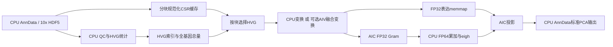

# 首版架构与执行边界

这是已经落地的顺序分块管线，**尚未实现 AIV/AIC 并发重叠、异步双缓冲或多卡**。AIV 变换结果可直接供 Gram 使用；另一次 D2H 用于持久化表达矩阵，后续投影重新分块读取。保留这条主机边界是为了有界内存、完整输出和复现旧实验，不能把它描述为全流程数据始终驻留 NPU。

## 模块

| 文件 | 职责与复用 |
|---|---|
| `pp.py` | AnnData API；复用 Scanpy QC/HVG，显式选择 Normalize/Log1p/PCA 后端 |
| `session.py` | 自有 FP32 数据快照；CSR values 与逐非零 row id 驻留，不修改 AnnData 类型 |
| `io.py` | legacy/v3 10x 读取、全局 int64 偏移、局部 int32 CSR、一次规范化与不可覆盖缓存 |
| `backend.py` | 严格 FP32 torch_npu MatMul、系数缓存与失效、CPU SciPy top-k eigh |
| `streaming.py` | 原百万细胞实验语义的可复现流式实现、分段计时、精度检查和产物导出 |
| `kernels/` | 一个有证据支持的 TileLang AIV 实验内核，不构建通用稀疏库 |

公开 AnnData API 与特定实验 CLI 的区别是刻意保留的：`pp.pca(scale=False)` 是默认普通 PCA；CLI 固定使用旧实验的单位方差、无 clipping PCA。CLI 的 Seurat HVG 采用稳定排序恰取 k 个，Scanpy 通用 HVG API 仍直接调用原库。两种语义均有文档，不冒充完全 drop-in 替代。

## 数据与内存

- 文件级 SHA-256 绑定源身份；缓存策略包含版本、形状、group、rows/nnz 上限。未完整生成 manifest 的缓存不会被读入。
- 原始矩阵 26 亿非零超过全局 int32；全局 `indptr` 保持 int64，每块重新基址化并限制 `nnz <= int32_max`。列索引在转换前检查 dtype 和值域。
- 规范化 CSR 合并重复坐标、删除存储零并排序；QC 检出数与非线性变换均基于规范化结果。
- 缓存中的 UMI 整数无损压缩为 int32；大整数/分数用 float64。读取检查布局、正有限数据、列范围与唯一有序坐标；当前不提供逐块内容 checksum。
- 百万数据的 compact CSR 缓存约 21.0 GB（十进制），每次完整输出另含约 10.45 GB 表达矩阵和 0.26 GB PCA scores。缓存空间不是零成本。
- 协方差工作区按六个 FP64 方阵保守预算。流式块同时受 cells 与 nnz 限制；结果表达使用 memmap。驻留 session 适合可放入设备内存的输入，不能替代 out-of-core 流程。
- 全局行偏移、逐细胞统计和 AnnData 元数据仍在主机内存，空间随细胞数增长；“分块”不表示任意规模下恒定 RSS。

## 数值与回退

FP32 MatMul 禁用 HF32，块间矩统计、协方差与特征分解为 CPU FP64。小矩阵 SVD 不再为了设备名而下发 NPU。PCA 方差、子空间、分数及抽样近邻分别检查；既有 FP32 SVD 也需要接受 CPU FP64 参考的检验。

实验 TileLang 路径显式启用。环境缺失、类型/形状不支持或范围不安全时直接报错，不把 CPU 执行伪装成 NPU 性能。成熟 Scanpy CPU 路径仍用于 QC/HVG。未来接入官方 CANN 稀疏算子前，要先验证当前 CANN/架构的真实能力与整数索引限制。

## 后续顺序

1. 在真实 910B/A2 复验编译、精度、端到端耗时；将环境组合固化为独立锁定环境。
2. 优先研究参数绑定的统计缓存与 I/O 预取；融合暂不默认开启，再测 AIV→AIC 双缓冲是否有端到端收益。
3. 基于官方 `ops-sparse` 做实际 SpMM 能力探测，再评估更高维/稀疏低秩 PCA；不要先重写 SpMM。
4. 扩展真实生物任务数据与 batch HVG/大规模邻居图验收，然后决定 neighbors/UMAP/Leiden 的 CPU/NPU 边界。
