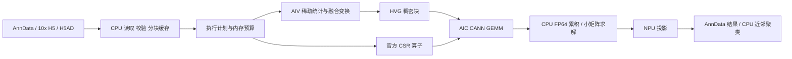

**singlecellNPU：第一阶段研究与设计报告**
调研日期：2026-11-04。推荐定位：**兼容 Scanpy/AnnData、面向大规模表达矩阵的 CPU–Ascend 协同分析引擎**。

结论：先复用现有 PCA 和 CANN，优化输入与数据流，再开发少量有端到端价值的稀疏融合算子。第一版贯通 QC → Normalize/Log1p → HVG → PCA；neighbors、UMAP、Leiden 先连接成熟 CPU 实现。通用 GEMM、自建完整稀疏库和全流程 NPU 化均不作为起点。

本次只读检查远端项目、实验源码、JSON 结果及既有 profiling 分析；本地保存研究源码和小型证据。没有修改 PCA/scops 实验、安装新依赖或重新跑百万级任务。下文明确区分「已实现」「既有实测」「研究方案」「设计建议」，所有预测均不是新测加速比。

**1. 先纠正硬件和基线口径**

你的目标是 **Ascend 910B/A2**，但 `cellfm` 当前设备查询与 PCA 结果一致：`Ascend910_9382`、runtime SoC `253`、24 Cube / 48 Vector 核；`npu-smi` 显示两个可见芯片分别有 65536 MB HBM，PyTorch 单设备属性显示约 62740 MB。vLLM-Ascend 的硬件识别源码将该型号及 SoC 范围归为 **A3**。因此，已有性能应标为当前 A3 服务器实测，不能宣称是 910B 成绩；研发可在当前机器继续，910B 发布验收需要真实 A2 设备。核数、HBM 和 tiling 必须查询设备，不硬编码。[硬件映射源码](https://github.com/vllm-project/vllm-ascend/blob/main/vllm_ascend/device/hardware.py)

现有环境：Linux aarch64、CANN 9.0.0、PyTorch 2.7.1、torch_npu 2.7.1.post4；scops 记录的 TileLang-Ascend 为 `0.1.1.10+ubuntu.20.4.cann900`。沿用 PCA 的 `env_npu.sh` 可以避开动态库冲突；不应为追随上游 master 而升级共享环境。目标项目远端目录目前为空。

**2. RAPIDS-singlecell：借鉴架构与语义，而非翻译 CUDA**

检查源码快照：`scverse/rapids-singlecell@c7a5c8229d5dca1c61eb4f3acdbd573d5d26cfac`。当前工程已不能仅用早期文章中的 `cunnData + CuPy RawKernel` 概括。

| 层次 | 当前实现与工程价值 | 对本项目的启示 |
|---|---|---|
| 生态接口 | `pp`/`tl` 与 Scanpy 接近；保留 AnnData 的 layer、mask、copy/inplace、结果字段约定 | 先写兼容契约与对照测试，避免新建一套分析生态 |
| 数据管理 | `get.anndata_to_GPU/CPU` 转换 X/layers；SciPy CSR/CSC 对应 CuPy 稀疏矩阵；元数据仍在 host | 显式管理驻留与回传，不在每个 API 内反复搬运全矩阵 |
| 通用计算 | CuPy 数组/稀疏操作、cuML 降维/嵌入、cuVS 近邻、cuGraph 聚类 | 用成熟基础库承载通用能力；Python 层负责单细胞语义和调度 |
| 专用计算 | 当前 `_cuda` 采用 CMake + nanobind 编译扩展，补 QC、moments、normalize、scale、稀疏 PCA 等 | 只补后端缺口与关键融合，不为每个 API 自研 kernel |
| 大规模运行 | RMM allocator/pool、可选 managed memory；部分算子有按行 Dask 分块和多 GPU 路径 | 学习预算与分块思路；不能假设 910B 有可直接替代 CUDA managed memory 的超配机制 |
| 验证 | 按功能组织 tests，包含 Scanpy 对照、稀疏/稠密、Dask 路径 | 测试统计语义和输出生态，而不只检查算子能否执行 |

源码入口：[数据迁移](https://github.com/scverse/rapids-singlecell/blob/c7a5c8229d5dca1c61eb4f3acdbd573d5d26cfac/src/rapids_singlecell/get/_anndata.py)、[编译扩展](https://github.com/scverse/rapids-singlecell/blob/c7a5c8229d5dca1c61eb4f3acdbd573d5d26cfac/CMakeLists.txt)、[内存管理](https://github.com/scverse/rapids-singlecell/blob/c7a5c8229d5dca1c61eb4f3acdbd573d5d26cfac/docs/memory_management.md)、[近邻后端](https://github.com/scverse/rapids-singlecell/tree/c7a5c8229d5dca1c61eb4f3acdbd573d5d26cfac/src/rapids_singlecell/preprocessing/_neighbors)、[聚类](https://github.com/scverse/rapids-singlecell/blob/c7a5c8229d5dca1c61eb4f3acdbd573d5d26cfac/src/rapids_singlecell/tools/_clustering.py)。

有三个值得深入借鉴的实现选择：

- **Normalize 按输入和参数分路。**CSR 指定 target_sum 时融合行求和与缩放；默认取总量中位数时需要全局统计，再做缩放。CUDA 内核依赖 warp shuffle、shared memory；这些执行模型不能照搬成 NPU SIMD 循环。[Normalize 源码](https://github.com/scverse/rapids-singlecell/blob/c7a5c8229d5dca1c61eb4f3acdbd573d5d26cfac/src/rapids_singlecell/preprocessing/_normalize.py)、[CUDA 行归约](https://github.com/scverse/rapids-singlecell/blob/c7a5c8229d5dca1c61eb4f3acdbd573d5d26cfac/src/rapids_singlecell/_cuda/norm/kernels_norm.cuh)
- **HVG 是混合计算。**大矩阵 moments 在 GPU，Seurat 分箱统计交给 pandas；Seurat v3 的 LOESS 调用 CPU `skmisc.loess`。把几万个基因的统计回传，比为了全 GPU 化重写所有统计过程更合理。Seurat 路径会对 log 输入做 expm1 后求 moments，不能把 log 后方差直接当成同一统计量。[HVG 源码](https://github.com/scverse/rapids-singlecell/tree/c7a5c8229d5dca1c61eb4f3acdbd573d5d26cfac/src/rapids_singlecell/preprocessing/_hvg)
- **PCA 是算法调度器。**该快照的稠密路径用 cuML；稀疏路径按特征数选择 covariance_eigh 或 Lanczos，另有 randomized SVD；Dask covariance 与 IncrementalPCA 是不同方法。隐式中心化用 `XV − 1(μᵀV)`，避免把全稀疏矩阵中心化成 dense。源码约 8000 特征的默认切换点是它的策略，不应直接成为 NPU 阈值。[PCA 分派](https://github.com/scverse/rapids-singlecell/blob/c7a5c8229d5dca1c61eb4f3acdbd573d5d26cfac/src/rapids_singlecell/preprocessing/_pca.py)、[隐式中心化](https://github.com/scverse/rapids-singlecell/blob/c7a5c8229d5dca1c61eb4f3acdbd573d5d26cfac/src/rapids_singlecell/preprocessing/_sparse_pca/_operators.py)

**3. Ascend 生态：基础能力已存在，单细胞整合层仍有空间**

检索范围包含 GitHub/GitCode、官方文档和论文，关键词覆盖 Ascend/NPU/昇腾 + single-cell/Scanpy/PCA/HVG/normalize_total/SpMM。截至本次调研，**未找到经核实、成熟且覆盖 Scanpy 常规分析流程的 Ascend 对应产品**。这不是“不存在任何相关代码”的证明；你的 `scops-tilelang` 已经是相关内部基础。2019 年 R 包 `ascend` 使用 CPU，名称与华为硬件无关。[原论文](https://pmc.ncbi.nlm.nih.gov/articles/PMC6735844/)

| 对象 | 核实状态 | 复用判断 |
|---|---|---|
| torch_npu / CANN | **已有实现，且本地 MatMul 已有实测**；公开 Log1p、SVD API | 保留 GEMM、基础向量/归约和设备运行时；API 支持不等于 AI Core 执行 |
| CANN `ops-sparse` | **官方源码已有实现**：SpMV、CSR SpMM、预处理、格式转换等；要求 CANN ≥9.0 | 通用稀疏能力的第一复用候选，不先重写 SpMM |
| `ops-sparse` Torch 扩展 | **源码提供接入**，含 SparseCsrPrivateUse1 路由与 `torch.sparse.mm/addmm` | 先测当前 torch_npu ABI、stream、workspace 与形状支持；没有在本机安装/实测 |
| TileLang-Ascend | **已有 A2/A3 后端与示例**，覆盖 GEMM、向量、归约等 | 用于单细胞专用融合原型；固定已有版本，不能把 950 后端新特性当成 910B 能力 |
| Ascend C | **已有编程与混合核接口** | 复杂索引搬运、跨核同步、库扩展优先复用；TileLang 表达或编译能力不足时使用 |
| AsNumpy / numpy-ascend | **公开科学数组项目**；后者自述 beta，稀疏与多 NPU 支持仍有限 | 关注 NumPy/CuPy 兼容方向，不据 API 覆盖率推断可直接运行 RAPIDS-singlecell |
| MindSpore sparse APIs | **逐 API/版本支持不同**；检查的 2.3 SparseTensorDenseMatmul 文档仅列 GPU/CPU | 不把“有 CSR 类型”误读成“所有 CSR 算子在 Ascend 高效执行”；本项目不额外引入完整框架 |
| Index SDK PCA | **文档存在向量降维算子**，旧文档含 310 场景 | 不能据此认定已提供 910B 百万细胞 PCA 拟合；以后可评估近邻检索模块 |

一手来源：[TorchNPU](https://github.com/Ascend/pytorch)、[CANN Log1p](https://www.hiascend.com/document/detail/zh/canncommercial/800/apiref/aolapi/context/aclnnLog1p%26aclnnInplaceLog1p.md)、[CANN SVD](https://www.hiascend.com/document/detail/zh/CANNCommunityEdition/850alpha002/API/aolapi/context/aclnnSvd.md)、[ops-sparse](https://gitcode.com/cann/ops-sparse)、[TileLang-Ascend](https://github.com/tile-ai/tilelang-ascend)、[Ascend C 混合核](https://www.hiascend.com/doc_center/source/en/CANNCommunityEdition/900/API/ascendcopapi/atlasascendc_api_07_0280.html)、[AsNumpy](https://gitcode.com/Ethan_Zou/asnumpy)、[numpy-ascend 限制](https://github.com/qingfengxia/numpy-ascend#limitations)、[MindSpore API](https://www.mindspore.cn/docs/en/r2.3.0/api_python/ops/mindspore.ops.SparseTensorDenseMatmul.html)、[Index SDK 算子](https://www.hiascend.com/document/detail/zh/mindsdk/300/index/indexug/mxindexfrug_0479.html)。AsNumpy 此次只核实到项目介绍，未完成其 PCA/稀疏源码审计。

**官方稀疏库的具体边界。**本地检查 `ops-sparse@092275d8335126f41ced7683d33303b21b1292ca`：`arch22` 覆盖 910B 与 910_93；CSR SpMM 底层要求 int32 行指针/列索引。公共 SpMM 文档及 host 源码含 A2/A3 转置、更多 dtype 路径，但 `arch22/README` 仍写旧的 FP32、N/N 限制，说明文档并未完全同步。第一轮能力矩阵必须验证 `A@B` 与 `A.T@B`、空行/长行、FP32 精度模式和预处理复用。Python wrapper 未必直接暴露所有 C API 选项。另有 910B Cube SpMM，输入 FP16、输出 FP32、COO→BCSR 预处理及宽度对齐约束，不能自动替代严格 FP32 分析。[SpMM 契约](https://gitcode.com/cann/ops-sparse/blob/092275d8335126f41ced7683d33303b21b1292ca/sparse/spmm/README.md)、[Torch 接入](https://gitcode.com/cann/ops-sparse/blob/092275d8335126f41ced7683d33303b21b1292ca/torch_extension/cann_ops_sparse/docs/zh/spmm.md)、[Cube SpMM](https://gitcode.com/cann/ops-sparse/blob/092275d8335126f41ced7683d33303b21b1292ca/sparse/cube_spmm/README.md)

**相关研究及其适用边界：**

| 工作 | 可借鉴内容 | 当前证据等级 |
|---|---|---|
| Moustafa，AccML 2023，*Accelerating Sparse Matrix-Matrix Multiplication with the Ascend AI Core* | 多级分块、局部稠密化，让 Cube 处理稀疏工作负载 | 论文研究；旧代 Ascend 910 结果，不能代表当前库基线。[论文](https://accml.dcs.gla.ac.uk/papers/2023/5th_AccML_paper_10.pdf) |
| *NeutronSparse*，2026 | 910B 上按稀疏性划分 AIC/AIV 工作、重排与复用 tile | 论文报告 1.26–7.78× NPU 基线收益；本次未核实独立可用的作者代码。不是单细胞实测。[论文](https://arxiv.org/abs/2606.22482) |
| *Ascend-SpMM*，2026-11-01 | 密度感知 AIC/AIV 分工、流水；仓库有 Ascend C 算子和 Torch 扩展 | 论文＋可读源码；仅发布数日。README 指定 20 AIC/40 AIV，wrapper 有宽度/对齐约束，图重排路径偏向方阵；单细胞矩形矩阵、FP32、转置与预处理成本需另测。未找到顶层 LICENSE，不直接复制进产品。[论文](https://arxiv.org/abs/2611.01936)、[代码](https://github.com/IDMG-Lab/Ascend-SpMM) |
| *Ascend to Science*，2026，LRSVD | NPU 负责 QB/Lanczos 主体，CPU 负责小矩阵 QR，反复正交化控制 FP32 误差 | PCA 相关研究方案；未核实可直接接入的 LRSVD 包。其容差与测试矩阵不同，不能继承论文加速比；“无 native SVD”的表述也不能覆盖现有 AI_CPU SVD。[论文 §6.1.2](https://arxiv.org/html/2607.20120v1#S6.SS1.SSS2) |

尚有优化空间的核心是：带 Scanpy 语义的稀疏统计、跨阶段数据复用、流式调度，以及经数值验证的 PCA 求解策略。稀疏注意力或 2:4 权重剪枝并不等价于任意 CSR 计数矩阵加速，不能为适配硬件改变生物数据。

**4. 你的 PCA 实验：可直接继承的成果与真正瓶颈**

核对了 `run_pca.py`、`npu_backend.py`、`summary.json`、分块计时、canonicalization audit、L0/L1 kernel/API 摘要和原有分析报告。数据为 **1,306,127 cells × 27,998 genes，2,624,828,308 nnz**；选择 2000 HVG，计算 50 PC。现有结果通过小样本 HVG/算法对照、生产协方差特征子空间及全量 score 统计检查，累计解释方差约 26.5485%。这是有价值的可信基线，但尚无同条件 CPU 全流程成绩，不能宣称整体 NPU 加速比。

| 原始运行计时范围 | 耗时 | 对 321.701 s 的占比 |
|---|---:|---:|
| Gram，160 次，含转换与搬运 | 2.454 s | 0.763% |
| 2000×2000 SVD，1 次 | 8.880 s | 2.760% |
| 投影，160 次，含搬运 | 1.396 s | 0.434% |
| 其他：I/O、预处理、初始化、参考校验、输出等 | 308.971 s | 96.043% |

由此得到反事实收益上限：即使完全消除 Gram＋投影，整体最多 **1.012×**；消除全部上述 NPU 调用也只有 **1.041×**。当前不值得优先重写 GEMM。

已有 host 分层抽样外推：两遍 HDF5 读取/解压约 **142.62 s**；CSR 排序/清理约 **44.86 s**；Pass 1 QC/归一化/moments 约 **25.80 s**；Pass 2 HVG 准备约 **28.02 s**。这些是热缓存样本外推，不能与原始阶段计时拼接为新的全量实测，更不能把差额全部叫 dispatch。原始 321.701 s 包含输入哈希、绘图和参考计算，但结束时间采在最终 H5AD 读回检查前；后续同时报告核心分析与完整进程 wall-clock。

源码与 profile 对应的优先处理项：

| 发现 | 位置与原因 | 推荐处置 |
|---|---|---|
| 同一压缩数据读两次 | `run_pca.py:106–120` 的 blocks() 被两遍调用 | Pass 1 顺便缓存紧凑 CSR；比较冷/热缓存、首次/复用总成本 |
| 每遍都排序及清理 | `run_pca.py:118–119` | 对这份已审计无重复/显式零的输入可走免排序路径；其他数据仍验证/规范化 |
| dense dtype 往返 | `run_pca.py:170` 与 `npu_backend.py:31–32`：FP64→FP32→FP64→FP32 | 中间表达保留 FP32；跨块统计才用 FP64 |
| SVD 实际为板载 AI_CPU | `npu_backend.py:54`；L1 `Svd/AI_CPU≈8.623s` | 优先比较已有 CPU `scipy.linalg.eigh(subset_by_index=...)`；不要先自研 SVD |
| 每块 Gram 阻塞回传 | `npu_backend.py:38` | 在精度不退化条件下评估批量/异步回传；收益受当前占比限制 |

应保留：全基因 totals、两遍 HVG 统计、CPU FP64 跨块累积、关闭 HF32 的 FP32 GEMM 基线、输入 SHA-256、输出与子空间校验。**当前单位方差缩放 PCA 是特定分析配方，不是 Scanpy PCA 默认行为；固定取恰好 2000 HVG 的稳定 tie-break 也需要显式记录，不能伪装成所有 Scanpy 版本的默认。**

已有自动 profile 分析的“纯 host op 100%”“MatMul 在 AI_CPU”“设备 idle 100%”与原始 kernel 摘要相矛盾：阻塞 `.cpu()` 等待了 SVD，且 trace 分类折叠了 AI_CPU。采用原始 kernel 行和已对齐 wall-clock；不重复计算同步等待。4 个约 26 MB 的短生命周期 tensor 是低优先级分配候选，不是内存不足证据。片段中的 Computing 时间也不是算法不可突破的物理下界。

**5. 整体架构与 NPU 特色（以下为设计建议）**

**生态层。**提供熟悉的 `pp.calculate_qc_metrics/normalize_total/log1p/highly_variable_genes/pca`；结果写回 obs/var、obsm、varm、uns。AnnData 继续保存标准 NumPy/SciPy/受支持的 backed 数据；不假定可将任意 torch_npu Tensor 直接塞进 X 并正常切片/写 H5AD。[AnnData 类型契约](https://anndata.readthedocs.io/en/stable/generated/anndata.AnnData.html)

**执行层。**内部 `NPUAnalysisSession` 管理 dense/CSR 三数组缓冲区、source layer、行列映射、变换状态与驻留状态；显式进入/退出会话、导出和 CPU fallback。会话持有受控快照；外部修改 X、切片或 layer 后必须重建/显式刷新，不能只按对象地址复用过期缓存。`uns` 只写可序列化的参数、后端、精度和版本，不保存设备指针。CPU fallback 一次回传必要数据、记录原因，避免悄悄逐算子往返。

**两种数据模式。**能容纳时让选定矩阵跨操作驻留；超预算时走按行流式路径和有界双缓冲。预算含 X、indices、workspace、Gram、输出、预取队列与临时副本。调度同时限制 cells 与 nnz，长行独立分块，不能固定“8192 行总能放下”。全局 indptr 用 int64，先减块起点，再检查并窄化到 int32——当前 nnz 已超过 2³¹−1，直接 cast 会溢出。

**先缩减搬运，再追求混合核。**示例 FP32 全基因 dense 约 146.3 GB，不能整体稠密化；2000-HVG dense 约 10.45 GB，可在预算允许时驻留。样本 HVG 密度约 8.07%，FP32 values＋int32 indices 约为对应 dense 的 16.1%（另加 indptr）；这说明“CPU 选 HVG → 传 HVG CSR → 设备生成 dense”有价值。反之，全基因紧凑 CSR 仅 values＋indices 就约 21 GB，可能比 HVG dense 搬运更多。密度和收益均应按实际块测量。

**AIV/AIC 分工。**AIV 处理行分段归约、缩放、log1p、局部展开；AIC 使用已有 GEMM 处理 Gram/投影。v1 先实现 AIV kernel → GM 缓冲区 → CANN GEMM，用 stream/event 和双缓冲重叠生产、H2D 与计算；不能声称调用外部 CANN GEMM 已经消除了中间 GM 流量。只有这一边界在更新后的 profile 中显著，才进一步研究 Ascend C/TileLang 混合核，将局部展开与矩阵 tile 调度结合，显式处理 UB/L1/L0、DMA、跨核同步和尾块。一个 8192×2000 块显然不能放进单核 UB。

**稀疏策略。**CSR 用于按细胞处理；列统计先试官方转置 SpMV/SpMM或分块归约，反复列访问才考虑缓存 CSC；不为一次统计无条件转换整矩阵。局部高密度块才考虑 BCSR/Cube，低密度或短行交给 AIV。分路需比较 `预处理成本/复用次数 + 搬运 + 计算 + 同步`，不能只按总体稀疏率判断。单细胞矩阵通常是不规则矩形，图论文中的方阵重排与重复训练收益不能直接套用。

**PCA 两条路径。**先保留 2000–4000 HVG 的流式 covariance：

`G = Σ Z_bᵀ Z_b; s = Σ Z_bᵀ 1; μ = s/n; C = (G − nμμᵀ)/(n−1)`。

其中 Z 是 log1p 后的 HVG 表达，1 是相应长度的全一向量，D 是基因样本标准差的对角阵；需要 scale 时计算 `D⁻¹ C D⁻¹`，V 为相应协方差的特征向量，scores 为 `Z D⁻¹ V − 1(μᵀ D⁻¹ V)`，无须显式保存中心化矩阵。clipping 会破坏这种纯线性等价，必须另走实现路径或明确拒绝。Gram 的 FP32 舍入与消减误差仍存在，CPU FP64 累积不能消除它们；出现近零方差、病态谱或明显负特征值时需要稳定 fallback，不能把 covariance 的奇异值无条件当有符号特征值。

更大基因维度再评估隐式中心化 randomized/block Krylov：`(X−1μᵀ)V` 与其转置乘积由官方 SpMM 驱动，小矩阵分解和必要正交化放 CPU。必须计入多遍扫描/转置、正交化和误差；协方差方法会平方条件数，而随机方法是近似方法，两者在 API 中明确区分。HVG 选择与特征分解都是全局屏障，不能把整条链声称为一次流式扫描。

**6. 第一版算子范围与优先顺序**

| 优先级 | 对用户提供的能力 / 内部算子 | 实施方式与边界 |
|---|---|---|
| P0 | 分块输入、校验、紧凑 CSR 缓存、数据驻留、标准结果写回 | CPU 与运行时工程；这是第一项性能工作 |
| P1 | QC：total_counts、n_genes、基因检测率、指定基因集比例 | CPU 参考＋AIV 行统计；基因维归约独立评估；top-N QC 可先 CPU |
| P1 | normalize_total、log1p；融合 fast path | 基础 torch_npu/CANN 路径先行；保留两步 API 可观察语义 |
| **P1 首个定制 kernel** | **HVG CSR＋全基因 totals → FP32 log1p dense block** | 复用原数学辅助函数，补长行、索引、dense 输出和尾块；生成块直接接已有 Gram |
| P1 | HVG Seurat dispersion | 大矩阵 moments 可 CPU/NPU 分路；分箱和排序用 CPU；v3/batch 作为后续扩展或明确 CPU fallback |
| P1 | centered PCA、可选无 clipping 的 unit-scale、投影 | 原生 GEMM＋CPU FP64；优先测 CPU top-k eigh 与当前 SVD，按代价选择 |
| P2 | 通用 SpMM 适配及随机/迭代 PCA | 先封装官方库，覆盖矩形、转置和精度；不先造新稀疏格式 |
| P2 | neighbors | CPU 可用路径先完成闭环；再研究 NPU ANN/距离候选，避免百万细胞全量 N² 距离矩阵 |

Normalize 不是 LayerNorm/RMSNorm，HVG 也不是简单 top-k 方差。默认 target_sum=None 的中位数、exclude_highly_expressed 的跨细胞基因掩码、空行、重复索引、隐式零、sample variance、Seurat/v3 输入区别均必须有明确语义。支持范围之外报错或显式 fallback，不能忽略参数。[Scanpy HVG](https://scanpy.readthedocs.io/en/stable/generated/scanpy.pp.highly_variable_genes.html)、[Scanpy Normalize](https://scanpy.readthedocs.io/en/stable/generated/scanpy.pp.normalize_total.html)

现有 `scops-tilelang@83ab5f70ef7bcd9350e5a5225357f398abef6a92` 可以复用环境适配、测试方法和 `log1p_nonnegative` 等基础片段；**不能直接作为百万细胞生产算子库**：单 tensor 上限 1,048,576 元素、最大行长 4096，而真实完整块有约 1400–1850 万 nnz、最大行长 8707；CSR 归一化函数对传入行求和，筛成 HVG 后直接使用会改变分母。pack/segment 还记录有特定形状正确性问题，当前版本不纳入新工具的可信依赖。新项目按本次指定的 singlecellNPU 目录开展，旧 scops 保留为可追溯参考，不搬动旧实验。

HVG 融合候选覆盖的原有阶段外推约 **20.87 s**，仅约总耗时 6.49%，还需扣掉 H2D、清零和新调度成本。若只加速归一化/log1p，两遍外推合计约 **5.43 s**；这正是必须做融合数据流、而不只追求一个 log kernel 的原因。

**7. 最值得突破的问题与开发路线**

最高优先级是**避免重复解压/排序，减少格式与精度转换，并让设备消费连续准备好的块**。核心算子难题是稀疏基因归约的热点、确定性与精度，以及将 HVG CSR 高效展开为 Cube 可用数据；算法研究难题是只求前 50 维时的稳定小矩阵/低秩求解。后续 NPU neighbors 可能成为分析闭环的新瓶颈，需要重新 profile 后决定投入。

| 里程碑 | 具体交付 | 进入下一阶段的条件 |
|---|---|---|
| M0：基线与契约 | 明确 A2 目标/A3 实测；固定依赖、输入与统计语义；能力表标记 AI_CORE/AIV/AI_CPU/host；接入 Scanpy 参考 | 相同输入输出下能够复现旧结果；仅环境 smoke test，不先优化 |
| M1：数据通路 | 去冗余排序、一次解压缓存、FP32 中间表示、有界预取；标准 AnnData adapter | 冷/热、首次/复用分别计时，整体和峰值内存改善；不以删掉输出/校验冒充加速 |
| M2：v1 分析链 | QC/Normalize/Log1p/HVG/PCA；官方库基线＋HVG 融合原型；CPU 后续流程入口 | 全量真实数据与边界用例通过；新算子只有在端到端收益为正时启用 |
| M3：稀疏与低秩扩展 | 官方 SpMM 分派、隐式中心化、迭代/随机 PCA、Seurat v3/batch 支持 | 预处理成本可摊销；残差、子空间、HVG 和下游图稳定性达标 |
| M4：完整流程扩展 | neighbors 优化、批次整合、必要时多 NPU 按细胞分片 | 先找到新的端到端瓶颈；统计/Gram 做归并，小矩阵求解一次，避免独立 PCA 后拼接 |

基准必须拆开四类收益：①原有流程→改良 CPU 数据通路；②同算法 CPU→原生 NPU/CANN；③同数据流原生 NPU→融合 kernel；④算法替换。与 RAPIDS 比较时统一数据、HVG、scale、solver 精度和输出范围，披露硬件，不能用论文倍数代替实测。

至少覆盖小型/十万/130 万细胞、2k/4k/较大基因集、不同密度、空行、重复及无序索引、长行和 nnz 跨 int32 的分块边界。沿用原 PCA 初始门槛：Gram 相对 Frobenius <2e−5、特征值相对误差 <2e−4、子空间最小余弦 >0.9999、残差 <2e−4；HVG 阈值与 ties 策略在实现前固定。比较子空间而非逐元素特征向量符号，后续补 kNN recall、图结构和细胞群稳定性检查。记录 wall-clock、cold/JIT/warm、H2D/D2H 字节、host RSS、NPU 峰值内存和 fallback；微基准只用来解释端到端结果。

后续近邻研究可参考 CPU–NPU 分工的 [Ascend-RaBitQ](https://arxiv.org/abs/2605.16007)，但它面向大规模向量检索，其量化与召回要求不等同于单细胞邻接图，先作为研究线。

**推荐批准的开发范围：M0 → M1 → M2；以“可靠的百万细胞混合分析链＋一个经验证有收益的 HVG 融合算子”为首版目标。**SpMM 优先复用官方实现；自研低秩 solver、混合 AIC/AIV SpMM 与 NPU 图分析在后续 evidence gate 后启动。本次仅完成研究设计，等待确认后实施。

**证据索引**

- 远端原始证据：`cellfm:/home/naie/work/slai/user-liuweiheng/PCA`；小型副本：[summary.json](research/pca-evidence/summary.json)、[性能分解](research/pca-evidence/analysis_metrics.json)、[profile 摘要](research/pca-evidence/profile_evidence.json)、[已有完整 PCA 分析](research/pca-evidence/PCA性能分析与TileLang候选.md)。
- 源码快照：`research/rapids-singlecell`、`research/ops-sparse`、`research/Ascend-SpMM`；Ascend-SpMM SHA `ca0abfeccf957d938ac8946a987f05aa6e9ec36c`。
- 复用审计：[scops README](research/scops-evidence/README.md)、[接口边界](research/scops-evidence/ops.py)。未复制原始数据矩阵及大型 trace。
- 本次只读设备查询：[hardware-query.txt](research/pca-evidence/hardware-query.txt)。该查询没有执行性能基准。
